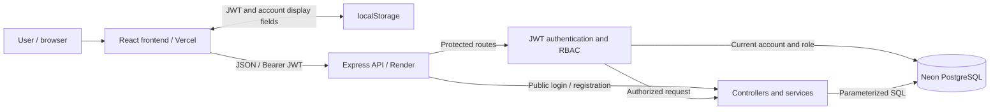

# System Architecture

## Architecture overview

WarrantyKeep is a React single-page application backed by an Express JSON API and PostgreSQL. Production hosting uses Vercel for React, Render for Express and Neon for PostgreSQL. The browser runs the UI, stores authentication state, and calls the API. Express validates input, verifies authentication and permissions, and executes parameterized SQL through `pg`; the browser never connects directly to PostgreSQL.

The API also applies Helmet headers, HTTPS checks in production, exact-origin CORS, request limits, a 16 KB JSON body limit, and error handling. Feature folders separate authentication, warranties, users, and dashboards; routes call controllers, and services contain SQL.

## Authentication flow

1. **Register:** React submits name, email and password to `POST /api/auth/register`. The API rejects additional fields, validates credentials, hashes the password with bcryptjs at cost 12, and inserts a `user` account. Registration returns public account fields; the UI then opens login.
2. **Login:** `POST /api/auth/login` checks the stored password hash. Success returns a JWT and the account's ID, name, email and role.
3. **Issue the token:** The API signs HS256 tokens with `JWT_SECRET`. Claims include the subject ID, issuer, audience, issued-at and expiration; lifetime is 30 minutes. The token contains no password or email.
4. **Store and send:** The frontend persists the token and required account display fields under `loggedUser` in localStorage. Protected API requests include `Authorization: Bearer <token>` and omit cookies.
5. **Verify:** `checkToken` checks signature, permitted algorithm, claims, expiration, maximum lifetime and subject ID. It then reloads the account and current role from PostgreSQL. Invalid tokens or deleted accounts return `401`.
6. **Expire/logout:** The client removes authentication state on logout, rejects malformed/expired persisted sessions, handles protected API `401` responses, and synchronizes tabs. The server remains the authority; browser-side decoding only supports expiry and navigation.

Logout does not revoke a copied, already issued JWT. It remains usable until expiration unless account deletion, signing-key rotation or a future revocation mechanism prevents it. Successful XSS can still steal localStorage tokens; see [security trade-offs](TECH_DECISIONS.md#important-technical-decisions).

## Authorization flow

Authentication establishes the account's identity. Authorization decides which operation that account may perform. `authorize(...)` middleware checks the database-derived role, while warranty SQL includes ownership predicates.

| Operation | Regular user | Administrator |
| --- | --- | --- |
| Create a warranty | Own account | Own account |
| List warranties/dashboard | Own data | Workspace overview and own/other-account histories |
| Update a warranty | Own warranty | Own warranty |
| Delete a warranty | Own warranty | Any warranty |
| List accounts | Denied | Allowed |
| Delete an account and its warranties | Denied | Regular accounts only; administrators cannot be deleted |

Admin routes return `403` for regular users. A warranty that does not exist or is outside the caller's ownership returns `404` for update/delete. Registration cannot set a role. Hiding routes/buttons in React improves the UI but cannot grant API permissions.

## Warranty CRUD flow

| Action | API and database behavior |
| --- | --- |
| Create | `POST /api/warranties`: validate permitted fields and insert with the authenticated user ID. |
| Read | `GET /api/warranties`: scope records by role/ownership, apply search/status filters, sort newest purchase first, and return rows, totals and pagination. The UI requests eight rows per page; the API caps requested limits at 50. |
| Update | `PUT /api/warranties/:id`: validate input, update only permitted columns, and require the authenticated owner's ID in SQL. |
| Delete | `DELETE /api/warranties/:id`: delete only if the caller is the owner or an administrator. |

PostgreSQL derives the end date from purchase date plus warranty months, clamping month ends. Status is active through the expiry date and expired on the following day, using `Asia/Manila` as the business date. The frontend preview uses equivalent calendar-month arithmetic. Expiry/status are calculated, not stored as mutable fields.

`users` stores account details, bcrypt hashes and roles. `warranties` references its owner by foreign key and has an owner index. Receipt URLs point to externally hosted HTTPS receipts; the application does not upload files. `DELETE /api/list-users/:id` locks a regular account, deletes its warranties, then deletes the account in one transaction; failure rolls both deletions back.

`GET /api/dashboard` returns role-specific aggregates. User dashboards include the next six active warranties. Admin dashboards include a 12-month expiry series, workspace/own totals and the six accounts holding the most warranties.

Mutations trigger list reloads through the current query state. Obsolete fetches are ignored, and the current page is corrected if a deletion/filter change leaves it beyond the last page.

## Deployment architecture

- **Vercel:** deploy `frontend/` with `npm run build` and output `dist`. `vercel.json` provides SPA deep-link rewrites and security headers.
- **Render:** configure the backend manually as a Node.js web service using the settings below. Express listens on `0.0.0.0` using Render's `PORT`.
- **Neon PostgreSQL:** the API uses the pooled Neon connection string as `DATABASE_URL`; migrations and administrative commands use a direct connection to the same branch/database. Use `sslmode=verify-full` for TLS with certificate and hostname verification. The existing `pg.Pool` accepts these URLs without a Neon SDK. Local development can still use local PostgreSQL or a separate Neon development branch.
- **Cross-domain API:** set frontend `VITE_API_BASE_URL` to the exact HTTPS API origin, without `/api`. Set backend `NODE_ENV=production`, `FRONTEND_ORIGIN` to the exact HTTPS frontend origin, and provide `JWT_SECRET` and `DATABASE_URL`. Additional frontend origins must be listed explicitly, comma-separated.
- **HTTPS/proxy:** production trusts one proxy hop and requires HTTPS for authentication/business endpoints. The non-sensitive GET/HEAD health probe also accepts internal HTTP. Confirm the proxy chain before adding another edge/proxy. `GET /api/health` is a liveness check; it does not execute a per-request database readiness query.
- **CSP:** Vite builds an HTML policy restricted to the configured API origin and same-origin scripts. Vercel's response policy adds framing and HTTPS restrictions. Browsers enforce both; rebuild the frontend after changing the API origin. Inline styles remain allowed for charts/development styles. Development permits Vite's inline preamble and local HMR.

### Manual Render setup

In the Render dashboard, create a Web Service, connect the repository, and configure:

| Setting | Value |
| --- | --- |
| Runtime | Node |
| Root Directory | `backend` |
| Build Command | `npm ci --include=dev && npm run build` |
| Start Command | `npm start` |
| Health Check Path | `/api/health` |

Set service environment variables `NODE_VERSION=24`, `NODE_ENV=production`, `DATABASE_URL` to the Neon pooled URL, `JWT_SECRET`, and `FRONTEND_ORIGIN`. Generate a random signing secret, for example with `openssl rand -base64 48`, and set the frontend origin to the exact HTTPS Vercel URL. Keep secrets in Render's environment settings. Let Render supply `PORT`.

The build explicitly includes development dependencies because TypeScript and the migration tool are development dependencies. Run migrations against Neon's direct URL before making the API available; the migration tool uses session-level advisory locks, which require a direct connection. Migrations and seeding do not run automatically during build or startup.

Optional production seeding requires `NODE_ENV=production`, `ADMIN_NAME`, `ADMIN_EMAIL`, and `ADMIN_PASSWORD`. It creates only the configured administrator; existing emails are left unchanged.

## Operational limits

Hosted Vercel/Render/Neon configuration, actual proxy headers, database TLS and browser/screen-reader behavior require verification in the deployed environment. Neon's Free plan has usage limits and scales compute to zero when idle; check the current [plan allowances](https://neon.com/pricing) and configure database privileges and backups for your needs. This documentation describes the implementation, not proof of complete security. Remaining security trade-offs are described in [Technology Decisions](TECH_DECISIONS.md).
